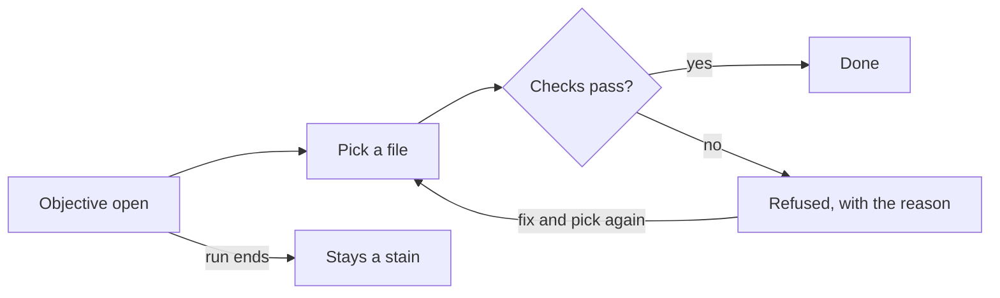

# StudyQuest — Design Doc

Nov 14, 2026 · Panayiotis Angelides · updated Nov 18, 2026

## Overview

StudyQuest is an Obsidian plugin that turns each university quarter into a game run. Courses are games, objectives are achievements, and each quarter's completion freezes into a permanent prestige record. It exists because starting study is the hard part, and a visible, permanent record is a stronger pull than a timer.

Design principles:

- **Objectives, not time.** Progress only comes from completed things: a lecture, an assignment, a lab, a reading, a step of progress. Minutes studied are never tracked.
- **History is permanent.** A closed quarter can't be edited. An incomplete quarter stays visible as a stain.
- **Honest by design.** No deleting, and evidence files that are checked before they count.
- **Lives where the work lives.** It runs inside the Obsidian vault that already holds all uni notes, so evidence is just the notes themselves.
- **Mac only.** Study stays off the phone. Viewing, adding and completing all happen on the Mac.

## Core concepts

Everything hangs off three things: **prestige run → course → objective**.

- **Prestige run.** A period with a start and end date, both entered manually from the TU Delft academic calendar. Normally a run is one quarter. The thesis is the exception: it is a single run that can span up to three quarters. When the end date passes, the run freezes into a prestige card in the history.
- **Course.** Belongs to one run and maps to a folder in the vault (e.g. `DSAIT4010/`). A course never extends past its run's end date.
- **Objective.** One completable thing. Its fields are title, type, course, a date (assignments and exams only), linked evidence and status. Lectures, labs, readings and progress objectives have no date and can be done anytime. A due date can't fall after the run's end date, and an exam date always falls within exam week (the run's last 7 days).
- **Resits.** The same course can appear in a later run if it has to be resat. Each attempt is its own course in its own run.

| Type | Example | Evidence |
| --- | --- | --- |
| Lecture | DSAIT4010 Lecture 5 | Lecture notes `.md` |
| Assignment | MDL Assignment 2 | Notebook `.ipynb` or submitted PDF |
| Lab | DSAIT4000 Lab 3 | Notebook or lab notes |
| Reading | Book, chapter 4 | Reading notes `.md` |
| Progress | Book chapters 1–5 | A set of sub-steps, each ticked separately |
| Exam | DSAIT4000 Final exam | None: completes automatically as **sat** once its date passes |

A **Progress** objective holds sub-steps (e.g. five chapters). It's complete only when all its sub-steps are, and the card shows a progress bar meanwhile.

## Rules

The prestige score means something because objectives can be added but never removed.

**Where objectives come from**

1. **Manual adding.** Objectives are added by hand in Setup, one at a time or as a numbered series (bulk-add), on every course at any time, because new things always come up. Roadmap and schedule import was dropped: without AI, every lecturer's layout would need its own reader.
2. **No deleting.** Objectives can't be edited or deleted. The one exception is a short undo window right after adding an objective, for typos (30 minutes). Any completion ends that window early.
3. **Locked dates.** A run's start and end dates lock once set, with the same 30-minute undo window.

**Completing an objective**

- **Done:** lectures, assignments and labs need an evidence file from the vault that passes the file checks (see File checks) and isn't already used by another objective. Readings are marked finished.
- **Sat:** exams only, set automatically once the exam date passes. A neutral mark.
- Both count as complete. The mark shows permanently on the objective.



A refused file can be fixed and picked again; there's no override.

**Run end and prestige tiers**

A run's end date is the university's official end date for that quarter (or, for the thesis, the last quarter it spans). When it passes, the run freezes. Anything still open becomes a permanent stain on that run's card.

Tier names are placeholders until a theme is chosen. Thresholds for tiers 1–4 are proposed.

| Tier | Condition |
| --- | --- |
| Tier 5 | 100% complete |
| Tier 4 | 95–99% |
| Tier 3 | 90–94% |
| Tier 2 | 85–89% |
| Tier 1 | 75–84% |
| Tier 0 (unranked) | Below 75% |

## Obsidian integration

StudyQuest is a community plugin written in TypeScript. It is desktop-only (`isDesktopOnly: true`) and targets Obsidian on the Mac. All its state lives in the vault.

**Linking notes to objectives**

- **File picker.** Completing a lecture, assignment or lab opens a searchable list of vault files, most recently changed first. Picking one links it as the evidence; it's shown on the objective and opens on click.
- **One file, one objective.** A file already used by another objective (in any run) is marked "used" and refused.
- **File checks.** Notebooks and notes must pass the rules in File checks; other files (PDFs, images, slides) are accepted as they are.
- **Course folders.** Each course gets its own vault folder, created when it's added (default `Courses/<CODE>/`); one folder per course, and a resit shares its old folder.

**Vault layout**

```
Courses/<CODE>/                ← a folder per course, created when the course is added
.obsidian/plugins/studyquest/
  log/2026-27-Q2.jsonl         ← append-only event log, one file per run (hidden from the vault)
  data.json                    ← plugin settings only (the run the switch last picked)
```

The log sits in StudyQuest's own plugin folder, so it never shows in the file explorer, search or the graph. Older versions kept it in a visible `StudyQuest/log/` folder; it is moved over once, on first start. Uninstalling the plugin deletes its folder, and the log with it, so back up `log/` first if you ever uninstall.

**Devices**

Everything runs on the Mac. The iPhone isn't a target. With Obsidian Sync, turn on the community-plugin options so the plugin folder (and with it the log) reaches other devices; the plugin doesn't load on mobile. StudyQuest re-reads the log whenever its window comes back into focus, to pick up synced changes.

## File checks

Plain rules, no AI. They run instantly when an evidence file is picked, and never again: an accepted file stays accepted even if it's later edited or deleted.

- **Notebooks (`.ipynb`).** Refused if the notebook can't be read, has no code cells, has an empty code cell, or has a `TODO` / `YOUR CODE HERE` comment still followed by a placeholder (`pass`, `...`, `None`, `raise NotImplementedError`). Saved outputs aren't required. The message names the cell, e.g. "Cell 15: the TODO is still `pass` (and 14 more)."
- **Notes (`.md`).** Refused if fewer than 5,000 characters remain after removing frontmatter.
- **Everything else** (PDFs, images, slides) passes.

**Later.** AI checks were tested on real notes (results in `docs/superpowers/specs/2026-11-17-phase-4-checks-design.md`): Apple's on-device model accepted every wrong title, and a local 9B model through Ollama was slow, heavy on this laptop and still unreliable, so they were left out. A remote API or a homelab could bring them back.

## Rewards and pixel character

Rewards stay small, and every run is a **roguelike run**: XP, level, coins and even the character start over each run. Overlapping runs keep their own. Everything is calculated from the log, so a retuned weight applies to past work too.

- **XP and coins.** A finished objective earns XP for its run: lecture 10, lab 15, assignment 40, exam sat 50, reading 5 per bump (at any level) plus 20 when finished, and 15 for an old Progress objective finished. Coins equal XP earned; coins get spent, XP never drops.
- **Levels.** Every run starts at level 1. Going from level L to L + 1 costs 50 + 10 × (L − 1) XP, so a quarter of about 1,200 XP (four courses with lectures, a few labs, assignments and exams) reaches about level 12.
- **Badges within a run.** Course complete (every objective of a course done) and Lecture sweep (every lecture of a course done). Badges show as icons; hovering one shows its name. They hold while their condition does and end with the run.
- **Permanent badges.** First prestige (first run closed), Tier 3 run (first close at Tier 3 or better) and Tier 5 run (first close at Tier 5). Each is credited to the run that earned it and shown on its Prestige Up screen.
- **Character (5b).** Each run makes a fresh pixel character (LPC art, forward-facing 2-frame breathing idle, male or female body): skin, head, face, eyes and hair are free at creation and any time after; a plain starter outfit is free; everything else is bought with that run's coins from a shop whose shelves open by level (1, 4, 8, 11), and a bought item comes in every colour. Badge items are never sold: Lecture sweep's nerd glasses and Course complete's star amulet for that run, and First prestige's scarf, Tier 3's cape and Tier 5's crown free in every later run. The art (about 1 MB, with credits for every artist) is built into the plugin. Spec: `docs/superpowers/specs/2026-11-18-phase-5b-character-design.md`.
- **Prestige snapshot.** Each prestige card keeps that run's character, so the Hall is a gallery of every character you've made.

## Screens and styling

Styling is unrestricted. Plugin views are plain HTML, CSS and canvas, so StudyQuest can ignore the Obsidian theme entirely and bring its own pixel font, colour palette, sprites and animations.

| Screen | Shows |
| --- | --- |
| Home | Completion ring, exam week, course list with %, character, open objectives (see `docs/Home Prototype Design.png`) |
| Setup | Run dates, courses, adding objectives |
| Course | One course's full objective list with marks, evidence links, completion % (opened from Home) |
| Objective | Linked evidence, DONE / SAT / OPEN / STAIN mark |
| Prestige hall | Past runs as cards: tier, %, level, stains, character snapshot; a run's page lists its badges |
| Character page | Opened from Home's character card: Wardrobe, Shop by level, Looks, art credits (creation page the first time) |

There's also a ribbon icon, a status-bar badge (e.g. "Q2 64%") and command-palette commands.

## Data model

All state is an append-only event log, one JSON object per line. Everything else (XP, completion %, tiers, coins) is calculated by replaying it, so new achievements can apply to past work.

```
{"id":"e_01J…","t":"2026-11-14T20:31:00Z","type":"objective_added","obj":"DSAIT4010-L05","course":"DSAIT4010","kind":"lecture","title":"Lecture 5","source":"manual"}
{"id":"e_01J…","t":"2026-11-16T10:02:00Z","type":"objective_completed","obj":"DSAIT4010-L05","tier":"silver","evidence":"DSAIT4010/Lecture 5.md"}
```

`"silver"` is the stored name for DONE.

| Event | Meaning |
| --- | --- |
| `quarter_created` / `quarter_closed` | A run starts (with its manual start and end dates) / freezes into a prestige card |
| `course_added` | A course joins a run, with its vault folder |
| `objective_added` | An objective added in Setup |
| `objective_undone` | Removal within the undo window only |
| `objective_completed` | DONE (stored as silver), with the evidence file's path when one is needed, or sat |
| `character_created` / `character_changed` | A run's character is made / its look is saved (body fixed) |
| `item_bought` / `purchase_undone` | A shop purchase, with the price paid (confirmed first; purchases are final) / an undo, kept in the format but not offered in the UI |

Every event has a unique ID. Replay de-duplicates by ID and orders by time, as a safeguard against accidental duplicate lines.

## Build plan

Phases 1–2 make it usable for Q2 with manual objectives. Each later phase adds one layer without changing the log format.

1. **Core loop.** Plugin scaffold, runs, courses, objectives, manual adding, self-claim, exam auto-sat, the event log, Home, course view and Setup. Spec: `docs/superpowers/specs/2026-11-16-phase-1-core-loop-design.md`.
2. **Prestige.** No-delete with an undo window, run close, tiers, Prestige hall.
3. **Evidence and readings.** An evidence file per completion, picked from the vault, one file per objective; readings as chapter counters. Spec: `docs/superpowers/specs/2026-11-17-phase-3-evidence-design.md`.
4. **File checks and one DONE mark.** Notebook and note rules on the picked file; silver and gold replaced by DONE. Spec: `docs/superpowers/specs/2026-11-17-phase-4-checks-design.md`.
5. **Character and rewards**, in two parts:
   - **5a. XP, levels, coins and badges.** Spec: `docs/superpowers/specs/2026-11-18-phase-5a-xp-design.md`.
   - **5b. Character, shop and wardrobe.** Spec: `docs/superpowers/specs/2026-11-18-phase-5b-character-design.md`.

Later, maybe: AI checks through a remote API or a homelab.

## Open questions

- [x] What does "complete" mean for each objective type? Answer: done = an evidence file that passes the file checks (lectures, assignments, labs) or marked finished (readings); exams are sat.
- [x] Courses that run across two quarters? Answer: no course takes more than a quarter except the final thesis, which takes 3. The thesis is one prestige run spanning those quarters.
- [x] Undo window for manual objectives? Answer: 30 minutes.
- [x] Should done count fully towards 100%, or partly? Answer: fully.
- [x] Exam objectives: keep them, and what counts as evidence? Answer: keep them. No evidence; they complete automatically as "sat" once their date (in exam week) passes.
- [x] Quarter board screen? Answer: dropped. Home plus the course view cover it.
- [x] Pixel art: draw it yourself, use a free asset pack, or a mix? Answer: free assets unless we can't find suitable ones, then draw.
- [x] Phone support? Answer: no. Mac only, to keep study off the phone.
- [x] How are run dates set? Answer: manually, from the university's official quarter dates. No course or due date goes past the end date.
- [ ] Tier names and the thresholds for tiers 1–4 (placeholders for now).
