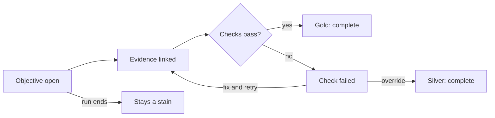

# StudyQuest — Design Doc

Nov 14, 2026 · Panayiotis Angelides · updated Nov 16, 2026

## Overview

StudyQuest is an Obsidian plugin that turns each university quarter into a game run. Courses are games, objectives are achievements, and each quarter's completion freezes into a permanent prestige record. It exists because starting study is the hard part, and a visible, permanent record is a stronger pull than a timer.

Design principles:

- **Objectives, not time.** Progress only comes from completed things: a lecture, an assignment, a lab, a reading, a step of progress. Minutes studied are never tracked.
- **History is permanent.** A closed quarter can't be edited. An incomplete quarter stays visible as a stain.
- **Honest by design.** Locked roadmaps, no deleting, and a visible difference between AI-verified and self-claimed work.
- **Lives where the work lives.** It runs inside the Obsidian vault that already holds all uni notes, so evidence is just the notes themselves.
- **Mac only.** Study stays off the phone. Viewing, adding, claiming and verifying all happen on the Mac.

## Core concepts

Everything hangs off three things: **prestige run → course → objective**.

- **Prestige run.** A period with a start and end date, both entered manually from the TU Delft academic calendar. Normally a run is one quarter. The thesis is the exception: it is a single run that can span up to three quarters. When the end date passes, the run freezes into a prestige card in the history.
- **Course.** Belongs to one run and maps to a folder in the vault (e.g. `DSAIT4010/`). It may have a roadmap and/or schedule, or neither. A course never extends past its run's end date.
- **Objective.** One completable thing. Its fields are title, type, course, source (roadmap or manual), an optional due date, linked evidence and status. A due date can't fall after the run's end date.

| Type | Example | Evidence |
| --- | --- | --- |
| Lecture | DSAIT4010 Lecture 5 | Lecture notes `.md` |
| Assignment | MDL Assignment 2 | Notebook `.ipynb` or submitted PDF |
| Lab | DSAIT4000 Lab 3 | Notebook or lab notes |
| Reading | Book, chapter 4 | Reading notes `.md` |
| Progress | Book chapters 1–5 | A set of sub-steps, each ticked separately |
| Exam (proposed) | Mock exam attempted | Self-claim, optionally with a score |

A **Progress** objective holds sub-steps (e.g. five chapters). It's complete only when all its sub-steps are, and the card shows a progress bar meanwhile.

## Rules

The prestige score means something because objectives can be added but never removed, and roadmap objectives are locked.

**Where objectives come from**

1. **Roadmap or schedule import.** Drop in the course roadmap and/or schedule. The plugin drafts a list of objectives, which you review, edit and then lock. After locking, those objectives can't be edited or deleted.
2. **Manual adding.** Allowed on every course at any time, including courses with a locked roadmap, because new things always come up.
3. **No deleting.** Neither imported nor manual objectives can be deleted. The one exception is a short undo window right after adding a manual objective, for typos (30 minutes).

**Completing an objective**

- **Gold:** you link evidence and it passes verification.
- **Silver:** you self-claim it, either because verification failed and you overrode it, or because there's nothing to upload (e.g. a paper book).
- Both count as complete. The difference shows permanently on the objective and in the run's prestige card.



A failed check can be fixed and retried, or overridden to silver. Self-claiming with nothing to upload goes straight to silver.

**Run end and prestige tiers**

A run's end date is the university's official end date for that quarter (or, for the thesis, the last quarter it spans). When it passes, the run freezes. Anything still open becomes a permanent stain on that run's card.

Tier names are placeholders until a theme is chosen. Thresholds for tiers 1–4 are proposed.

| Tier | Condition |
| --- | --- |
| Tier 5 | 100% complete |
| Tier 4 | 95–99% |
| Tier 3 | 90–94% |
| Tier 2 | 85–89% |
| Tier 1 | 75–84% |
| Tier 0 (unranked) | Below 75% |

## Obsidian integration

StudyQuest is a community plugin written in TypeScript. It is desktop-only (`isDesktopOnly: true`) and targets Obsidian on the Mac. All its state lives in the vault.

**Linking notes to objectives**

- **Frontmatter tag.** A note with `objective: DSAIT4010-L05` in its frontmatter is picked up automatically as that objective's evidence.
- **Command.** "Link current note to objective" in the command palette, so you never have to type IDs.
- **Course folders.** Each course maps to a vault folder. When a new note appears there, the plugin suggests which open objective it belongs to.
- **Non-markdown evidence.** Notebooks, PDFs and other files in the vault can be linked by path.

**Vault layout**

```
StudyQuest/
  log/2026-27-Q2.md     ← append-only event log, one file per run
  roadmaps/             ← imported course roadmaps and schedules
.obsidian/plugins/studyquest/
  data.json             ← plugin settings only
```

**Devices**

Everything runs on the Mac. The iPhone isn't a target. If the vault is synced to other devices the log is just a file there, but the plugin doesn't load on mobile.

## AI verification

Verification runs locally on the Mac. Simple rule checks come first, and Apple's on-device Apple Intelligence model handles only the judgement calls, with Ollama as the fallback. It checks that the work looks complete, not that you understood it.

**Two stages**

1. **Rule checks (no AI, instant).** For a notebook: every code cell has code, cells have outputs, and nothing like `TODO` or `raise NotImplementedError` is left. For notes: not empty and above a minimum length.
2. **Model check (on-device, local).** For notes: compare the note against the lecture's topic list, taken from the roadmap or slide text, and judge whether most topics are covered. The model returns pass or fail plus a one-line reason, which is saved in the log.

**Setup**

- **First choice: Apple Intelligence on-device model.** A desktop plugin can run commands, so it can call Apple's model in one of two ways:
  - A Shortcut using the Use Model action set to On-Device, run from the plugin with `shortcuts run`. This is the quickest to prototype.
  - A small Swift command-line helper using Apple's Foundation Models framework. It gives more control and a structured pass/fail result.
- Apple Intelligence must be switched on. The on-device model is small and has a short context window, so long notes are checked in chunks.
- **Fallback: Ollama** at `localhost:11434` with a small model, if Apple's model proves too weak or slow on real notes.
- On a failure the reason is shown, and you can fix the work and retry, or override to silver.

**Ollama model picks (for the fallback)**

| Model | Ollama tag | Download | Context | Role |
| --- | --- | --- | --- | --- |
| Qwen3.5 9B | `qwen3.5:9b` | 6.6–7.6 GB | 256K | First pick: fits in 18 GB alongside Obsidian, reads text and images |
| Qwen3.5 4B | `qwen3.5:4b` | 3.3–4.0 GB | 256K | Lighter backup if the 9B is too slow |
| Gemma 4 12B | `gemma4:12b` | 7.7–8.0 GB | 256K | Alternative to test against the 9B |

- Use Ollama's structured outputs (a JSON schema in `format`) so every verdict comes back as `{"pass": bool, "reason": string}`.
- Turn thinking mode off for speed, and cap the context at about 16–32K tokens to save memory.
- Pick by testing: run 5–10 real lecture notes through Apple's model, the 4B and the 9B, and keep the smallest that judges them correctly.

Sources: [Ollama qwen3.5](https://ollama.com/library/qwen3.5), [Ollama gemma4](https://ollama.com/library/gemma4).

The exact meaning of "complete" for each type is still to be decided (see Open questions).

## Rewards and pixel character

Rewards stay small. Coins buy everyday cosmetics, and the best cosmetics can only be earned through achievements.

- **XP and levels.** Every completed objective gives XP, weighted by type (an assignment is worth more than a lecture). Gold gives a bonus over silver.
- **Coins.** Earned with XP and spent in a small cosmetics shop.
- **Achievement unlocks.** Some cosmetics can't be bought, e.g. for a course at 100%, a first Tier 5 run, or every lecture in a course gold.
- **Character.** Layered pixel sprites (base, hair, top, bottom, accessory, background) at a small native size, scaled up with crisp pixels. The details are still open.
- **Prestige snapshot.** Each prestige card keeps the outfit you wore that run, so the history doubles as a wardrobe timeline.

## Screens and styling

Styling is unrestricted. Plugin views are plain HTML, CSS and canvas, so StudyQuest can ignore the Obsidian theme entirely and bring its own pixel font, colour palette, sprites and animations.

| Screen | Shows |
| --- | --- |
| Home | Character, level, XP bar, current run's completion |
| Quarter board | Every course and its objectives, with status and due dates |
| Course | One course's objectives, roadmap lock state, completion % |
| Objective | Linked evidence, verify button, verification result, gold or silver |
| Prestige hall | Past runs as cards: tier, %, stains, outfit snapshot |
| Wardrobe and shop | Equip and buy cosmetics, see locked achievement items |
| Roadmap import | Drop in a roadmap, review the drafted objectives, lock |

There's also a ribbon icon, a status-bar badge (e.g. "Q2 64%") and command-palette commands.

## Data model

All state is an append-only event log, one JSON object per line. Everything else (XP, completion %, tiers, coins) is calculated by replaying it, so new achievements can apply to past work.

```
{"id":"e_01J…","t":"2026-11-14T20:31:00Z","type":"objective_added","obj":"DSAIT4010-L05","course":"DSAIT4010","kind":"lecture","source":"roadmap"}
{"id":"e_01J…","t":"2026-11-16T10:02:00Z","type":"objective_completed","obj":"DSAIT4010-L05","tier":"gold","evidence":"DSAIT4010/Lecture 5.md","reason":"Covers 6 of 7 topics"}
```

| Event | Meaning |
| --- | --- |
| `quarter_created` / `quarter_closed` | A run starts (with its manual start and end dates) / freezes into a prestige card |
| `course_added` | A course joins a run, with its vault folder |
| `objective_added` | Imported or manual objective |
| `roadmap_locked` | A course's imported objectives become fixed |
| `objective_undone` | Removal within the undo window only |
| `evidence_linked` | A note or file is attached to an objective |
| `verification_run` | Result of a check: pass/fail + reason |
| `objective_completed` | Gold or silver |
| `purchase` / `equip` | Shop and wardrobe actions |

Every event has a unique ID. Replay de-duplicates by ID and orders by time, as a safeguard against accidental duplicate lines.

## Build plan

Phases 1–2 make it usable for Q2 with manual objectives. Each later phase adds one layer without changing the log format.

1. **Core loop.** Plugin scaffold, runs, courses, objectives, manual adding, self-claim, the event log, Quarter board view.
2. **Prestige.** No-delete with an undo window, run close, tiers, Prestige hall.
3. **Obsidian linking.** Frontmatter tags, course folders, the link command, evidence on objectives.
4. **Verification.** Rule checks for notebooks and notes, Apple on-device model check (Ollama as fallback), gold vs silver.
5. **Roadmap import.** Drop in a roadmap or schedule, get a drafted objective list, review, lock.
6. **Character and rewards.** XP, levels, coins, shop, wardrobe, pixel sprites, outfit snapshots.

## Open questions

- [ ] What does "complete" mean for each objective type?
- [x] Courses that run across two quarters? Answer: no course takes more than a quarter except the final thesis, which takes 3. The thesis is one prestige run spanning those quarters.
- [x] Undo window for manual objectives? Answer: 30 minutes.
- [x] Should silver count fully towards 100%, or partly? Answer: fully.
- [ ] Exam objectives: keep them, and what counts as evidence?
- [x] Pixel art: draw it yourself, use a free asset pack, or a mix? Answer: free assets unless we can't find suitable ones, then draw.
- [x] Phone support? Answer: no. Mac only, to keep study off the phone.
- [x] How are run dates set? Answer: manually, from the university's official quarter dates. No course or due date goes past the end date.
- [ ] Tier names and the thresholds for tiers 1–4 (placeholders for now).
- [ ] Can a due date change on a locked roadmap objective if the course moves a deadline?
