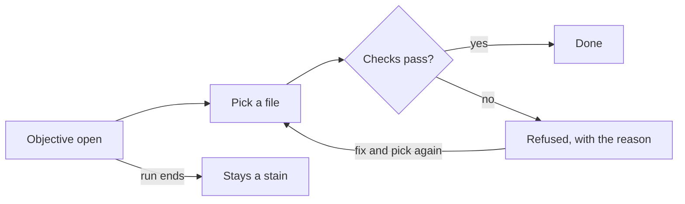

# StudyQuest — Design Doc

Nov 14, 2026 · Panayiotis Angelides · updated Nov 17, 2026

## Overview

StudyQuest is an Obsidian plugin that turns each university quarter into a game run. Courses are games, objectives are achievements, and each quarter's completion freezes into a permanent prestige record. It exists because starting study is the hard part, and a visible, permanent record is a stronger pull than a timer.

Design principles:

- **Objectives, not time.** Progress only comes from completed things: a lecture, an assignment, a lab, a reading, a step of progress. Minutes studied are never tracked.
- **History is permanent.** A closed quarter can't be edited. An incomplete quarter stays visible as a stain.
- **Honest by design.** Locked roadmaps, no deleting, and evidence files that are checked before they count.
- **Lives where the work lives.** It runs inside the Obsidian vault that already holds all uni notes, so evidence is just the notes themselves.
- **Mac only.** Study stays off the phone. Viewing, adding and completing all happen on the Mac.

## Core concepts

Everything hangs off three things: **prestige run → course → objective**.

- **Prestige run.** A period with a start and end date, both entered manually from the TU Delft academic calendar. Normally a run is one quarter. The thesis is the exception: it is a single run that can span up to three quarters. When the end date passes, the run freezes into a prestige card in the history.
- **Course.** Belongs to one run and maps to a folder in the vault (e.g. `DSAIT4010/`). It may have a roadmap and/or schedule, or neither. A course never extends past its run's end date.
- **Objective.** One completable thing. Its fields are title, type, course, source (roadmap or manual), a date (assignments and exams only), linked evidence and status. Lectures, labs, readings and progress objectives have no date and can be done anytime. A due date can't fall after the run's end date, and an exam date always falls within exam week (the run's last 7 days).
- **Resits.** The same course can appear in a later run if it has to be resat. Each attempt is its own course in its own run.

| Type | Example | Evidence |
| --- | --- | --- |
| Lecture | DSAIT4010 Lecture 5 | Lecture notes `.md` |
| Assignment | MDL Assignment 2 | Notebook `.ipynb` or submitted PDF |
| Lab | DSAIT4000 Lab 3 | Notebook or lab notes |
| Reading | Book, chapter 4 | Reading notes `.md` |
| Progress | Book chapters 1–5 | A set of sub-steps, each ticked separately |
| Exam | DSAIT4000 Final exam | None: completes automatically as **sat** once its date passes |

A **Progress** objective holds sub-steps (e.g. five chapters). It's complete only when all its sub-steps are, and the card shows a progress bar meanwhile.

## Rules

The prestige score means something because objectives can be added but never removed, and roadmap objectives are locked.

**Where objectives come from**

1. **Roadmap or schedule import.** Drop in the course roadmap and/or schedule. The plugin drafts a list of objectives, which you review, edit and then lock. After locking, those objectives can't be edited or deleted.
2. **Manual adding.** Allowed on every course at any time, including courses with a locked roadmap, because new things always come up.
3. **No deleting.** Neither imported nor manual objectives can be deleted. The one exception is a short undo window right after adding a manual objective, for typos (30 minutes). Any completion ends that window early.
4. **Locked dates.** A run's start and end dates lock once set, with the same 30-minute undo window.

**Completing an objective**

- **Done:** lectures, assignments and labs need an evidence file from the vault that passes the file checks (see File checks) and isn't already used by another objective. Readings are marked finished.
- **Sat:** exams only, set automatically once the exam date passes. A neutral mark.
- Both count as complete. The mark shows permanently on the objective.



A refused file can be fixed and picked again; there's no override.

**Run end and prestige tiers**

A run's end date is the university's official end date for that quarter (or, for the thesis, the last quarter it spans). When it passes, the run freezes. Anything still open becomes a permanent stain on that run's card.

Tier names are placeholders until a theme is chosen. Thresholds for tiers 1–4 are proposed.

| Tier | Condition |
| --- | --- |
| Tier 5 | 100% complete |
| Tier 4 | 95–99% |
| Tier 3 | 90–94% |
| Tier 2 | 85–89% |
| Tier 1 | 75–84% |
| Tier 0 (unranked) | Below 75% |

## Obsidian integration

StudyQuest is a community plugin written in TypeScript. It is desktop-only (`isDesktopOnly: true`) and targets Obsidian on the Mac. All its state lives in the vault.

**Linking notes to objectives**

- **Frontmatter tag.** A note with `objective: DSAIT4010-L05` in its frontmatter is picked up automatically as that objective's evidence.
- **Command.** "Link current note to objective" in the command palette, so you never have to type IDs.
- **Course folders.** Each course maps to a vault folder. When a new note appears there, the plugin suggests which open objective it belongs to.
- **Non-markdown evidence.** Notebooks, PDFs and other files in the vault can be linked by path.

**Vault layout**

```
StudyQuest/
  log/2026-27-Q2.md     ← append-only event log, one file per run
  roadmaps/             ← imported course roadmaps and schedules
.obsidian/plugins/studyquest/
  data.json             ← plugin settings only
```

**Devices**

Everything runs on the Mac. The iPhone isn't a target. If the vault is synced to other devices the log is just a file there, but the plugin doesn't load on mobile.

## File checks

Plain rules, no AI. They run instantly when an evidence file is picked, and never again: an accepted file stays accepted even if it's later edited or deleted.

- **Notebooks (`.ipynb`).** Refused if the notebook can't be read, has no code cells, has an empty code cell, or has a `TODO` / `YOUR CODE HERE` comment still followed by a placeholder (`pass`, `...`, `None`, `raise NotImplementedError`). Saved outputs aren't required. The message names the cell, e.g. "Cell 15: the TODO is still `pass` (and 14 more)."
- **Notes (`.md`).** Refused if fewer than 5,000 characters remain after removing frontmatter.
- **Everything else** (PDFs, images, slides) passes.

**Later.** AI checks were tested on real notes (results in `docs/superpowers/specs/2026-11-17-phase-4-checks-design.md`): Apple's on-device model accepted every wrong title, and a local 9B model through Ollama was slow, heavy on this laptop and still unreliable, so they were left out. A remote API or a homelab could bring them back.

## Rewards and pixel character

Rewards stay small. Coins buy everyday cosmetics, and the best cosmetics can only be earned through achievements.

- **XP and levels.** Every completed objective gives XP, weighted by type (an assignment is worth more than a lecture).
- **Coins.** Earned with XP and spent in a small cosmetics shop.
- **Achievement unlocks.** Some cosmetics can't be bought, e.g. for a course at 100%, a first Tier 5 run, or every lecture in a course done.
- **Character.** Layered pixel sprites (base, hair, top, bottom, accessory, background) at a small native size, scaled up with crisp pixels. The details are still open.
- **Prestige snapshot.** Each prestige card keeps the outfit you wore that run, so the history doubles as a wardrobe timeline.

## Screens and styling

Styling is unrestricted. Plugin views are plain HTML, CSS and canvas, so StudyQuest can ignore the Obsidian theme entirely and bring its own pixel font, colour palette, sprites and animations.

| Screen | Shows |
| --- | --- |
| Home | Completion ring, exam week, course list with %, character, open objectives (see `docs/Home Prototype Design.png`) |
| Setup | Run dates, courses, adding objectives |
| Course | One course's full objective list with marks, roadmap lock state, completion % (opened from Home) |
| Objective | Linked evidence, DONE / SAT / OPEN / STAIN mark |
| Prestige hall | Past runs as cards: tier, %, stains, outfit snapshot |
| Wardrobe and shop | Equip and buy cosmetics, see locked achievement items |
| Roadmap import | Drop in a roadmap, review the drafted objectives, lock |

There's also a ribbon icon, a status-bar badge (e.g. "Q2 64%") and command-palette commands.

## Data model

All state is an append-only event log, one JSON object per line. Everything else (XP, completion %, tiers, coins) is calculated by replaying it, so new achievements can apply to past work.

```
{"id":"e_01J…","t":"2026-11-14T20:31:00Z","type":"objective_added","obj":"DSAIT4010-L05","course":"DSAIT4010","kind":"lecture","source":"roadmap"}
{"id":"e_01J…","t":"2026-11-16T10:02:00Z","type":"objective_completed","obj":"DSAIT4010-L05","tier":"silver","evidence":"DSAIT4010/Lecture 5.md"}
```

`"silver"` is the stored name for DONE.

| Event | Meaning |
| --- | --- |
| `quarter_created` / `quarter_closed` | A run starts (with its manual start and end dates) / freezes into a prestige card |
| `course_added` | A course joins a run, with its vault folder |
| `objective_added` | Imported or manual objective |
| `roadmap_locked` | A course's imported objectives become fixed |
| `objective_undone` | Removal within the undo window only |
| `evidence_linked` | A note or file is attached to an objective |
| `objective_completed` | DONE (stored as silver) or sat |
| `purchase` / `equip` | Shop and wardrobe actions |

Every event has a unique ID. Replay de-duplicates by ID and orders by time, as a safeguard against accidental duplicate lines.

## Build plan

Phases 1–2 make it usable for Q2 with manual objectives. Each later phase adds one layer without changing the log format.

1. **Core loop.** Plugin scaffold, runs, courses, objectives, manual adding, self-claim, exam auto-sat, the event log, Home, course view and Setup. Spec: `docs/superpowers/specs/2026-11-16-phase-1-core-loop-design.md`.
2. **Prestige.** No-delete with an undo window, run close, tiers, Prestige hall.
3. **Obsidian linking.** Frontmatter tags, course folders, the link command, evidence on objectives.
4. **File checks and one DONE mark.** Notebook and note rules on the picked file; silver and gold replaced by DONE. Spec: `docs/superpowers/specs/2026-11-17-phase-4-checks-design.md`.
5. **Roadmap import.** Drop in a roadmap or schedule, get a drafted objective list, review, lock.
6. **Character and rewards.** XP, levels, coins, shop, wardrobe, pixel sprites, outfit snapshots.

Later, maybe: AI checks through a remote API or a homelab.

## Open questions

- [x] What does "complete" mean for each objective type? Answer: done = an evidence file that passes the file checks (lectures, assignments, labs) or marked finished (readings); exams are sat.
- [x] Courses that run across two quarters? Answer: no course takes more than a quarter except the final thesis, which takes 3. The thesis is one prestige run spanning those quarters.
- [x] Undo window for manual objectives? Answer: 30 minutes.
- [x] Should done count fully towards 100%, or partly? Answer: fully.
- [x] Exam objectives: keep them, and what counts as evidence? Answer: keep them. No evidence; they complete automatically as "sat" once their date (in exam week) passes.
- [x] Quarter board screen? Answer: dropped. Home plus the course view cover it.
- [x] Pixel art: draw it yourself, use a free asset pack, or a mix? Answer: free assets unless we can't find suitable ones, then draw.
- [x] Phone support? Answer: no. Mac only, to keep study off the phone.
- [x] How are run dates set? Answer: manually, from the university's official quarter dates. No course or due date goes past the end date.
- [ ] Tier names and the thresholds for tiers 1–4 (placeholders for now).
- [ ] Can a due date change on a locked roadmap objective if the course moves a deadline?
